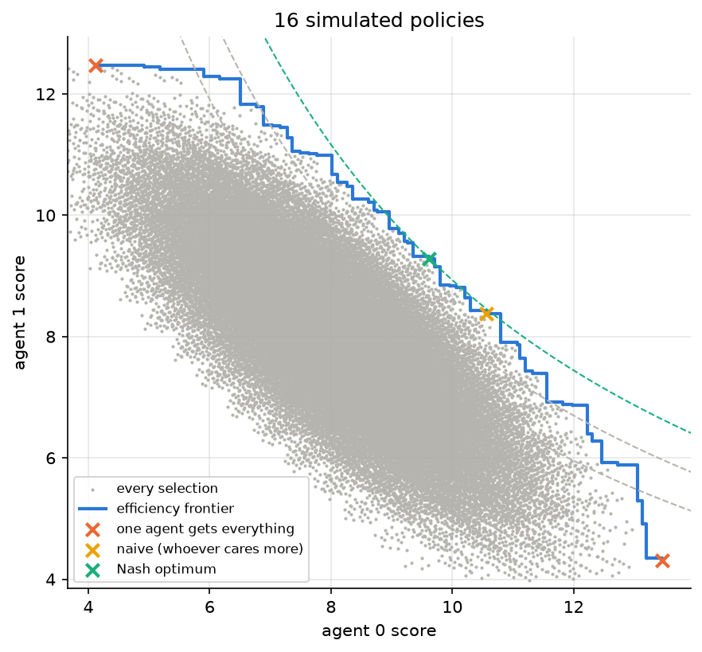
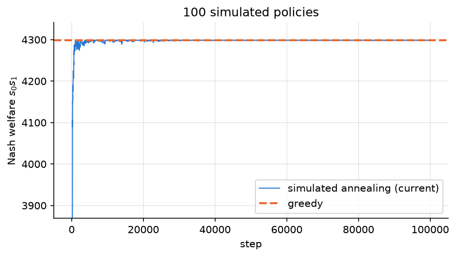
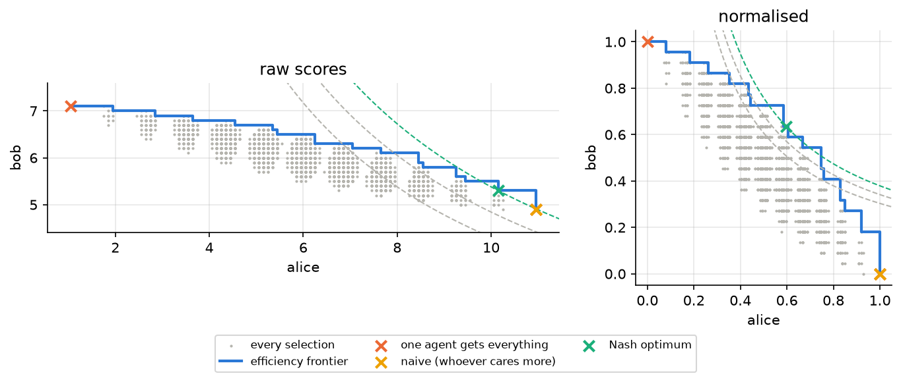

# Optimal bilateral preferences

The idea for this came about when moving in with someone. There were lots of small decisions where we each had a preference: where the couch should go, where the pots live, etc. What I found happened was that whoever had the stronger opinion won always, which is fair enough on each decision individually, but the small losses for the other person "add up", so they should eventually be able to "cash that in" to win one.

The same thing shows up anywhere two parties pick between a bunch of yes/no options: policies affecting two groups, majority votes, roommates. "Go with whoever cares more" can mean one side always wins. So the question is: given a list of decisions and how each side feels about them, which split is best for *both*?

**Summary:** use Nash welfare (maximise $\ln s_0 + \ln s_1$, the log of each person's score), on the scores people give. Using raw scores means that the more relaxed person still loses often, but not always. Whether the relaxed person losing often is a problem depends on *why* they're relaxed. If they genuinely don't mind, Nash on the raw scores already gets it right. If they do care but don't say so, the inputs are wrong, and normalising is worth considering. One approach for normalising is to scale everyone so their worst case is 0 and best case is 1, this is a fairly crude fix and can sometimes go wrong, so it's not the default and needs justification. Finding the optimal split is easy in practice: greedy is optimal in 93-98% of random problems and never more than ~1.5% off, and brute force is fine up to about 20 decisions.

Most of the numbers and plots below come from [`notebooks/main.ipynb`](../notebooks/main.ipynb). The examples in [Normalising](#normalising) don't.

## The setup

There are $n$ decisions (policies), each either done (1) or not (0). A selection is a binary vector $\pi$ of length $n$.

There are two agents (people, parties, whatever). Each has a score $s_a(\pi)$, assumed to add up over the decisions, so $s_a(\pi)=\sum_i s_{a,i}(\pi_i)$. That ignores decisions that interact with each other (the couch and the TV probably do), but it keeps things simple.

### The 50:50 rule

To actually get the scores, each person says how they lean on each decision, something like "I'm 70:30 in favour". Doing it gives them 0.7, not doing it gives them 0.3. This is nice because nobody can claim more than 1 per decision, so everyone has the same "budget" of caring. It's already a kind of normalisation, built into how the scores are collected, which matters later.

Writing $p_{a,i}$ for person $a$'s lean towards "yes" on decision $i$, the score is linear:

$$s_a(\pi) = b_a + m_a \cdot \pi, \qquad b_a = \sum_i (1-p_{a,i}), \qquad m_{a,i} = 2p_{a,i} - 1$$

so $b_a$ is their score if everything is a "no" and $m_a$ is how much each "yes" changes it.

### What to optimise

The obvious options:

- **Utilitarian**, maximise $s_0 + s_1$. Decision by decision, this just goes with whoever leans harder. This is the "naive" option and the thing I'm trying to avoid.
- **Egalitarian**, maximise $\min(s_0, s_1)$.
- **Nash**, maximise $\ln s_0 + \ln s_1$, or equivalently the product $s_0 s_1$.

I went with Nash, so the problem is

$$\max_{\pi\in\{0,1\}^n} \; \ln(b_0 + m_0\cdot\pi) + \ln(b_1 + m_1\cdot\pi).$$

### Why the sum of logs

**It counts percentage changes, not absolute ones.** Say flipping one decision changes the scores by $\Delta s_0$ and $\Delta s_1$. For small changes, the log sum goes up when

$$\frac{\Delta s_0}{s_0} + \frac{\Delta s_1}{s_1} > 0,$$

so a flip is worth it when one person's *percentage* gain beats the other's percentage loss. The utilitarian rule compares absolute changes ($\Delta s_0 + \Delta s_1 > 0$), so whoever leans harder wins whatever has gone before. Under Nash, the more someone has already won, the more they need to gain before taking one more thing off the other person. That's the "you've won the last five, let them have this one" intuition.

**It doesn't care about units.** Multiply someone's scores by a constant $k$ and their log goes up by $\ln k$ everywhere, so the best selection doesn't change. That means the two people don't need to agree on a scale, and nobody gains by inflating all their numbers. Neither of the other two options has this. If Alice reports in percent and Bob in fractions, the utilitarian answer is just "whatever Alice wants".

**It sits between the other two.** All three are part of one family,

$$W_\eta = \sum_a \frac{s_a^{1-\eta}}{1-\eta},$$

where $\eta$ is how much you care about inequality. $\eta = 0$ is utilitarian (doesn't care who gets what), $\eta \to \infty$ is egalitarian (only cares about the worse-off person, however much it costs the other), and $\eta = 1$ is the log. In economics this is constant relative risk aversion, and $\eta=1$ is the only member that's scale invariant per person. Utilitarian ignores fairness completely, and egalitarian will happily make both people much worse off for a tiny gain to one of them. The log is the middle ground.

**Nobody gets left with nothing.** $\ln s \to -\infty$ as $s \to 0$, so leaving one person with nothing is never optimal, however much the other person gains.

**It's the Nash bargaining solution.** Nash (1950) showed that if you want a rule that is Pareto efficient (never leaves anything on the table that would make one person better off for free), symmetric (swap the names and the answer swaps), doesn't care about units, and doesn't change its mind when options it didn't pick are taken away, the only one is maximising

$$\ln(s_0 - d_0) + \ln(s_1 - d_1),$$

where $d_a$ is each person's **disagreement point**, what they'd get if no deal is reached. Plain Nash welfare is the case $d_a = 0$. Under the 50:50 rule a score of 0 means every decision went against someone who was 100% sure about all of them, so measuring from zero means measuring from "as bad as anyone can possibly do".

The one thing the log doesn't settle is that baseline: percentage gains *relative to what*. That's what normalising is really about.

## The efficiency frontier

Every selection gives a point $(s_0, s_1)$. For 16 random decisions there are $2^{16}=65{,}536$ of them, so we can just plot all of them.

The simulated data uses two beta distributions skewed in opposite directions, so the two agents mostly disagree, with plenty of strong opinions.

Each agent's best case is easy: just take every decision their way. Between those two corners is the **efficiency frontier**, the most agent 1 can get for each level of agent 0's score. Every sensible selection is on it. Tracing it exactly is a knapsack problem (maximise $s_1$ subject to $s_0 \geq c$), so NP-hard in general, but with 16 decisions brute force is instant.

The dashed lines are constant Nash welfare. The optimum is where the frontier touches the highest one. The cloud of points looks like a bivariate normal, which makes sense: each score is a sum of lots of random bits, so central limit theorem.

Here the naive answer isn't far off the optimum, because both agents have similarly strong opinions. The interesting case is when one of them is much more relaxed than the other (see [Normalising](#normalising)).

## Solving it

### Brute force

Check all $2^n$ selections. Guaranteed optimal, fine up to about 20 decisions, hopeless past that.

### Greedy

Start with everything "no". Repeatedly flip whichever decision improves $s_0 s_1$ the most, and stop when nothing helps.

### Simulated annealing

Start with everything "no", flip a random decision, keep it if it's better, and sometimes keep it even if it's worse. The temperature cools like $T_0/\sqrt{1+k}$.

On 100 decisions it gets to the greedy answer in a few thousand steps and then sits there.

### Continuous relaxation

Let each $\pi_i$ be anywhere in $[0,1]$. Expanding the objective,

$$
(m_0^T\pi + b_0)(m_1^T\pi + b_1) = \pi^T M \pi + c^T\pi + b_0 b_1, \qquad M = m_0 m_1^T, \quad c = b_0 m_1 + b_1 m_0
$$

and swapping $M$ for the symmetric $Q=\frac12(M+M^T)$ gives a quadratic program with box constraints. $Q$ is rank 2 and indefinite, so it isn't convex, but scipy handles it fine at these sizes. Then round to the nearest selection.

In practice the relaxed solution is already (almost) binary. On 100 decisions not a single entry came out fractional. That makes sense: the objective only depends on the two scores, so the relaxed optimum sits on the edge of the 2D set of achievable scores. That set is a polygon whose corners are real selections, and any point on an edge is a mix of two neighbouring corners that differ in just one decision. So at most one entry is fractional.

### How do they compare?

Checking against brute force on 200 random problems with 16 decisions:

| solver | raw: optimal | raw: worst | normalised: optimal | normalised: worst |
|---|---:|---:|---:|---:|
| greedy | 98% | 99.4% | 93% | 98.6% |
| simulated annealing (20k steps) | **100%** | 100% | **100%** | 100% |
| continuous relaxation, rounded | 98% | 99.9% | 98% | 99.7% |
| naive (whoever cares more) | 46% | 90.0% | 54% | 88.7% |

"Worst" is the worst welfare as a fraction of the true optimum. "Normalised" is the same problems with each person rescaled so their worst case is 0 and best is 1 (see [Normalising](#normalising)). It's just there as a second, differently shaped set of test problems.

Greedy is *nearly* always optimal and never meaningfully off, but it isn't guaranteed. It makes sense that it's close: the frontier's corners can be traced by sorting the decisions by their trade-off $m_{0,i}/m_{1,i}$, which is basically what greedy does. It's when the true optimum sits between two of those corners (the knapsack bit) that greedy can miss.

On bigger problems (50 to 1000 decisions) all three land on the same answer, to 5 decimal places. Greedy and the relaxation take well under a second at 500 decisions. Annealing takes a second or so whatever the size, and greedy gets slow-ish at 1000 (~2s), since every step tries every remaining decision.

## Normalising

### Moving in

The actual motivating case, from [`examples/moving_in.csv`](../examples/moving_in.csv). Alice has strong opinions (leans of 0.85-0.95 or 0.05-0.15) and Bob is fairly relaxed about everything (0.35-0.70), and they mostly disagree.

| | Alice | Bob | yes to |
|---|---:|---:|---:|
| naive | 10.95 (100%) | 4.90 (0%) | 6/12 |
| Nash, raw scores | 10.15 (92%) | 5.30 (18%) | 7/12 |
| Nash, normalised | 6.95 (60%) | 6.30 (64%) | 9/12 |

The percentage is how far each person is from their worst case (0%) to their best case (100%). "Normalised" means rescaling each person so their worst case is 0 and their best case is 1 (min-max normalisation), then doing Nash on that.

Naive gives Alice everything, and Nash on the raw scores only gives Bob one decision out of twelve. Bob's leans are all close to 0.5, so even if he got everything his way his score would only go from 4.9 to 7.1, while Alice's goes from 1 to 11. The log helps someone near zero, but Bob is never near zero, since a relaxed person scores about $n/2$ whatever happens. In percentage terms each decision barely moves him.

On the raw scale (left) the frontier is long and flat, so the Nash curve touches it way over at Alice's end. Normalised, they both end up about 60% of the way to everything they wanted.

### What normalising actually does

Min-max normalisation does two things to each person: shifts their score so their worst case is 0, and divides by their range. For Nash, the second step does nothing, since the log doesn't care about units (see [above](#why-the-sum-of-logs)). Running it with only the shift gives exactly the same scores in every example here.

So normalising is entirely a change of **baseline**. Raw Nash measures everyone's gains from 0 (as bad as anyone could possibly do). Normalised Nash measures them from *that person's* worst case on *these* decisions, which is the Nash bargaining solution with the disagreement point at each person's worst case. That's a real modelling choice, not a harmless rescaling, and it needs a reason.

### Case 1: Bob genuinely doesn't mind much

If Bob really is close to indifferent, raw Nash is right and the lopsided split is fine. Losing a 60:40 decision costs Bob 0.2. Losing a 95:5 one costs Alice 0.9. The 50:50 rule already gives everyone the same budget of caring, so Bob being near 0.5 *is* the information that he doesn't mind. "Bob only won 1 of 12" sounds bad, but he lost very little.

Normalising throws that information away. Because it's scale invariant per person, it can't tell a Bob who leans 60:40 from one who leans 51:49. Take Bob's leans and squash them to 48.5-52% (so he barely cares about anything) and the normalised answer is *identical* to the one for the real Bob above: Alice drops from 100% to 60%, losing 4 points, so Bob can gain 0.14.

It gets worse when someone has almost no opinions at all. Say Bob is exactly 50:50 on everything except the couch, where he's 55:45 in favour, and Alice is 5:95 against:

| | Alice | Bob | couch under the window? |
|---|---:|---:|---|
| Nash, raw scores | 10.95 (100%) | 5.95 (0%) | no |
| Nash, normalised | 10.05 (91%) | 6.05 (100%) | yes |

Normalised, the couch is Bob's whole range, so not getting it puts him at 0, and $\ln 0 = -\infty$. His 55:45 beats her 95:5. Under normalisation, any preference, however mild, is a veto if it's the only one you have.

### Case 2: Bob cares but doesn't say so

This is what I think was actually going on when moving in. Some people say "I don't mind, whatever you think" when they do mind, to avoid an argument, or because they're agreeable, or just because they use a narrower range of numbers. Then the reported leans understate how much they care, and raw Nash just optimises the wrong inputs. You end up back at the original problem: the person who doesn't push loses everything.

To make that concrete, suppose Bob's real leans are 2.25 times as far from 50:50 as what he said (so his 60:40 is really 72.5:27.5, and his 70:30 is 95:5). Scoring each split by his *real* leans:

| decided using | Alice | Bob (real) |
|---|---:|---:|
| raw Nash, what Bob said | 10.15 (92%) | 4.43 (18%) |
| raw Nash, what Bob really thinks | 8.45 (75%) | 5.78 (45%) |
| normalised Nash, what Bob said | 6.95 (60%) | 6.68 (64%) |

Normalising moves things in the right direction. It isn't recovering the truth though. In this example it overshoots, since it effectively assumes both people care exactly as much in total. The 2.25 is made up, but some made-up number like it is always hiding inside a normalisation.

So this is the case where normalising is justified. But what it's doing is correcting the *inputs* (Bob's leans don't reflect what he thinks), not changing the objective. It should be done because you have a reason to think someone is underselling themselves, not by default.

### Thoughts on which to use

- Use Nash on the raw 50:50 scores by default. The 50:50 rule already puts everyone on the same budget, and the log already looks after whoever is losing.
- If you think someone is underselling how much they care, fix that in their leans. Ask again, or stretch their leans away from 50:50 by a factor you can actually defend, then run raw Nash on that.
- Min-max normalisation is the extreme version of that fix, where you assume both people care exactly as much in total. That's a fair thing to assume when moving in (the whole point was that Bob should be generally happy with the place too), but you should choose it deliberately, knowing that it can't tell mild opinions from no opinions, and that it's thrown off by a single strong one.

## Things I didn't get to

- A better correction for under-voicing than min-max, e.g. scaling each person's leans by a robust measure of how far they typically sit from 50:50 (median rather than total), so one strong opinion doesn't set the scale for everything else.
- Decisions that interact (the couch position depends on where the TV goes). The scores stop being linear, but brute force and annealing don't care.
- More than two people. Nash welfare generalises fine (sum of everyone's logs), and so do all the solvers.
- Tracing the frontier with greedy instead of brute force, then picking the best point on it.
- Looking into options for scoring that can't be "gamed" by people (c.f. Vickrey-Clarke-Groves mechanism)

## Bugs

The first version had a couple of bugs:

- **Greedy added the wrong policy.** It found the best policy to add, then updated the scores using whatever policy the loop happened to finish on. When everyone agrees, it would end up implementing things nobody wanted. There's a test for this now.
- **The brute force used** $\ln(s_0 + s_1)$ instead of $\ln(s_0) + \ln(s_1)$, so it was actually finding the naive (utilitarian) answer, not the Nash one.
- **Annealing ran too hot on normalised problems.** The temperature started at $2n$, which suits raw scores but is massive when welfare lives in $[0,1]$. It found the optimum only 46% of the time. It now starts at the biggest change a single flip makes, so it scales with whatever welfare you use.
